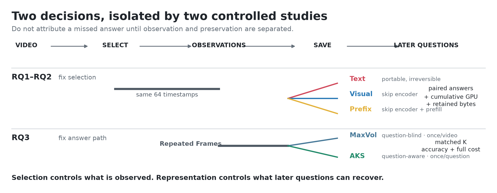

  

  <h2>REEL: Same Frames, Different Answers and Different Costs</h2>

  
<strong>WACV 2027 · Datasets &amp; Evaluation Track</strong>

  <!--
  Add the camera-ready author list and affiliations here once confirmed.
  Use linked names, affiliation superscripts, and an equal-contribution note
  when applicable, following the structure used by the SlideGen README.
  -->

  

    
    
    
    
  

> [!IMPORTANT]
> **Public project page, private research code.** This repository contains the
> public website only. The code repository remains private until a fresh
> environment can install the package, run the documented tests, and complete
> an end-to-end GPU smoke test on legally obtained data. The current checks are
> useful staging evidence, not a public reproducibility claim.

## Overview

Long-video systems often observe a video once and answer many questions later.
REEL asks what those systems should retain so that reuse is both cheaper and
faithful to the original answers.

The evaluation separates two decisions that are often mixed together:

1. **Evidence selection:** which frames are observed?
2. **Memory representation:** what is saved for later questions?

For a fixed set of observed frames, REEL compares **Frames**, **Text**,
**Visual features**, and **Prefix State** using three ledgers:

- paired changes in which individual questions are answered correctly;
- cumulative GPU work as the number of questions grows; and
- retained storage in bytes.

  

## Main findings

The following values come from the accepted-paper analysis. They must be
checked once more against the camera-ready manuscript before public release.

| Comparison | Accepted-paper result |
| --- | --- |
| Text vs. Frames | **21.1–29.6%** of jointly valid questions change correctness |
| Visual vs. Frames | **0.0–2.3%** of question outcomes differ |
| Prefix State vs. Frames | **0.3–2.8%** of question outcomes differ |
| Text storage | Approximately **6.1–8.6 KiB per video** |
| Prefix State storage | Approximately **1.06–20.97 GiB per video** |
| Question-aware selection | **+6.2–7.6 pp** on CG-Bench, **−0.1–1.5 pp** on HD-EPIC, at **1.63–5.59×** total GPU time |

Under the tested models, datasets, frame budgets, and answer-retention checks,
Prefix State is the lowest-GPU eligible saved representation in the main
workloads. This is a conditional result, not a universal ranking.

## Release map

| Component | Location | Current status |
| --- | --- | --- |
| Project page | This repository | Public static website |
| Research code | [REEL-code](https://github.com/LiangXin1001/REEL-code) | Private whitelist candidate; 76 CPU tests pass |
| Public paper | Not included | Camera-ready or preprint PDF pending |
| Data and videos | Not redistributed | Access and license instructions pending |
| Model checkpoints | Not redistributed | Exact revisions and download instructions pending |
| License | Not selected | Author approval required |

The confidential review manuscript is intentionally excluded from Git
history.

## Reproducibility gate

This checklist defines when the separate research-code repository can be made
public. The project-page repository is already public.

- [x] Start from a new, clean Git history.
- [x] Copy research code from an explicit whitelist.
- [x] Pass 76 selected CPU tests.
- [x] Remove symbolic links and files larger than 10 MB from the code candidate.
- [x] Run first-pass scans for personal cluster paths and common secret formats.
- [ ] Merge the approved code candidate into the approved public code repository.
- [ ] Install successfully in a fresh environment using only documented steps.
- [ ] Run the full CPU test suite from that fresh environment.
- [ ] Add a small, legally redistributable smoke-test fixture.
- [ ] Complete one documented end-to-end GPU smoke test.
- [ ] Reproduce the headline tables and figures with documented commands.
- [ ] Pin model IDs, revisions, preprocessing, generation settings, and hardware.
- [ ] Complete third-party license and attribution review.
- [ ] Run a full-history secret scanner such as Gitleaks.
- [ ] Add the approved open-source license.
- [ ] Add final authors, affiliations, public paper, and BibTeX.
- [ ] Verify every README and project-page number against the camera-ready paper.

## Preview the project page

The current repository is a buildless static website:

~~~bash
git clone https://github.com/LiangXin1001/REEL.git
cd REEL
python -m http.server 8000
~~~

Then open <http://localhost:8000>.

This command previews the website only; it does not reproduce the paper
experiments.

## Validate the current code candidate

Collaborators with access to the private code candidate can run the present
CPU checks as follows:

~~~bash
git clone git@github.com:LiangXin1001/REEL-code.git
cd REEL-code
python -m pip install -e '.[analysis,dev]'
PYTHONPATH=src:scripts python -m pytest -q
~~~

The observed staging result is:

~~~text
76 passed
~~~

This result was obtained in the existing research environment. A clean-machine
installation and GPU inference test are still pending.

## Repository layout

~~~text
REEL/
├── assets/       # Logo, paper figures, and study diagrams
├── index.html    # Project-page content
├── styles.css    # Responsive project-page styling
├── script.js     # Representation tabs, lightbox, and reveal interactions
└── README.md     # Release status and reproducibility gate
~~~

The private code candidate currently uses:

~~~text
REEL-code/
├── src/pestate/          # Core selectors, timing, parsing, and cost utilities
├── scripts/              # Controlled runner and paper-analysis tools
├── tests/                # Redistributable CPU tests
├── configs/environments/ # Recorded research-environment versions
└── docs/                 # Data, model, third-party, and release notes
~~~

## Citation

The final BibTeX entry will be added after the camera-ready author order and
proceedings metadata are confirmed. Do not cite or redistribute the
confidential review manuscript.

## License

No public license has been selected yet. Until an approved license is added,
the website content and research code remain all rights reserved.
